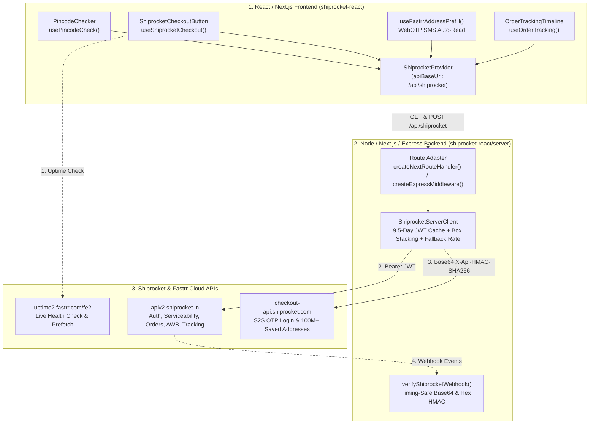

# `shiprocket-react`

A full-stack **React.js + Server SDK** that connects custom **React**, **Next.js**, and **Express** applications to **Shiprocket Shipping** and **Shiprocket Checkout (Fastrr & Built-in Express Checkout)** — built on top of protocol specifications reverse-engineered directly from Shiprocket's official **Shopify** and **WooCommerce** plugins.

---

## Table of Contents

1. [Why This Library Exists](#1-why-this-library-exists)
2. [Architecture Overview](#2-architecture-overview)
3. [Reverse-Engineered Findings (Shopify & WooCommerce)](#3-reverse-engineered-findings-shopify--woocommerce)
4. [Quick Start](#4-quick-start)
   - [Next.js App Router Setup](#option-a-nextjs-app-router-appapishiprocketactionroutets)
   - [Express.js Setup](#option-b-expressjs-serverts)
   - [Sandbox Mode (No Live Keys Required)](#option-c-local-sandbox-mode-zero-credentials-needed)
5. [React Client SDK Reference](#5-react-client-sdk-reference)
   - [`<ShiprocketProvider />`](#shiprocketprovider-)
   - [`<PincodeChecker />` & `usePincodeCheck()`](#pincodechecker---usepincodecheck)
   - [`<ShiprocketCheckoutButton />` & `useShiprocketCheckout()`](#shiprocketcheckoutbutton---useshiprocketcheckout)
   - [`useFastrrAddressPrefill()` (1-Click OTP Address Autofill)](#usefastrraddressprefill-1-click-otp-address-autofill)
   - [`<OrderTrackingTimeline />` & `useOrderTracking()`](#ordertrackingtimeline---useordertracking)
6. [Server SDK Reference (`shiprocket-react/server`)](#6-server-sdk-reference-shiprocket-reactserver)
   - [`ShiprocketServerClient` Methods](#shiprocketserverclient-methods)
   - [`calculatePackageDimensions()`](#calculatepackagedimensionsitems)
   - [`verifyShiprocketWebhook()`](#verifyshiprocketwebhookrawbody-headers-options)
   - [Built-in Route Handler Actions](#built-in-route-handler-actions)
7. [Interactive Browser Playground & Testing](#7-interactive-browser-playground--testing)
8. [Project File Structure](#8-project-file-structure)

---

## 1. Why This Library Exists

Shiprocket provides first-party plugins only for **Shopify**, **WooCommerce**, and **Magento**. Custom React / Next.js storefronts face four major roadblocks when integrating Shiprocket directly:

1. **No Official React SDK**: Calling `apiv2.shiprocket.in` directly from browser code leaks your Shiprocket email, password, and JWT bearer token, and fails due to CORS restrictions.
2. **Undocumented Fastrr Checkout Protocol**: Shiprocket's 1-click checkout (`checkout-api.shiprocket.com` / `fastrr-boost-ui.pickrr.com`) uses specific HMAC-SHA256 Base64 signature headers (`X-Api-HMAC-SHA256`) and undocumented S2S OTP endpoints that are hidden inside their WooCommerce PHP plugin and Shopify storefront scripts.
3. **240-Hour Token Management**: Shiprocket's JWT token expires every 10 days (240 hours) and requires server-side caching + automatic 401 token refresh.
4. **Unit & Box-Stacking Mismatches**: Cart items stored in grams or inches cause inaccurate courier rate quotes unless normalized and stacked into a single bounding parcel before calling `/v1/external/courier/serviceability/`.

`shiprocket-react` solves all of these out of the box with a clean **Client (`shiprocket-react`) + Server (`shiprocket-react/server`)** architecture.

---

## 2. Architecture Overview



---

## 3. Reverse-Engineered Findings (Shopify & WooCommerce)

We reverse-engineered three official Shiprocket codebases to ensure 100% protocol compatibility:
- **WooCommerce Shipping Plugin** (`shiprocket-woocommerce-shipping-calculator.php`, `class-shiprocket-woocommerce-shipping-method.php`)
- **WooCommerce Fastrr Checkout Plugin** (`class-shiprocketlogin-core.php`, `public/js/login.js`)
- **Shopify Fastrr Checkout Script** (`https://fastrr-boost-ui.pickrr.com/assets/js/channels/shopify.js`)

### Key Protocol Discoveries Built Into `shiprocket-react`

| Protocol Feature | Official Source | Exact Specification Implemented in `shiprocket-react` |
| :--- | :--- | :--- |
| **Base64 Raw-Binary HMAC** | `class-shiprocketlogin-core.php` & `login.js` | `X-Api-HMAC-SHA256` MUST be computed over raw binary SHA-256 bytes and encoded as **Base64** (`createHmac('sha256', secret).update(rawBody).digest('base64')`), **not** hex. |
| **Fastrr S2S OTP Initiate** | `class-shiprocketlogin-core.php` | `POST https://checkout-api.shiprocket.com/api/v1/access-token/s2s-login/initiate` with `{"mobileNumber":"9876543210"}` signed with `X-Api-Key` and `X-Api-HMAC-SHA256`. |
| **Fastrr S2S OTP Verify** | `class-shiprocketlogin-core.php` | `POST https://checkout-api.shiprocket.com/api/v1/access-token/s2s-login/verify` with `{"otp":"123456","token":"..."}` returning an `access_token`. |
| **Fastrr Saved Address Fetch** | `class-shiprocketlogin-core.php` | `POST https://checkout-api.shiprocket.com/api/v1/customer-data` with `{"token":"<access_token>","address":true}` — returns the shopper's saved addresses across Shiprocket's 100M+ buyer network. |
| **WebOTP SMS Auto-Read** | `public/js/login.js` | Uses `navigator.credentials.get({ otp: { transport: ['sms'] } })` with an `AbortController` to automatically read incoming 6-digit OTPs on mobile browsers. |
| **Fastrr Uptime Circuit-Breaker** | `channels/shopify.js` | Pings `GET https://uptime2.fastrr.com/fe2` (`1` = healthy, `0` = outage) with a 2.5s timeout before launching Fastrr, automatically falling back to built-in checkout if Fastrr is down. |
| **Non-iOS Iframe Prefetch** | `channels/shopify.js` | Warms browser cache via a hidden `0x0` iframe to `https://fastrr-boost-ui.pickrr.com/?prefetch=true` on non-iOS browsers without the 79KB `MutationObserver` bloat of `shopify.js`. |
| **WooCommerce Box Stacking** | `class-shiprocket-woocommerce-shipping-method.php` | Converts `grams -> kg` (`* 0.001`), `inches -> cm` (`* 2.54`), sorts each item's 3 dimensions ascending (`d0 <= d1 <= d2`), takes `max(d2)` as length, `max(d1)` as breadth, and sums `d0 * units` as stacked height. |
| **Fallback Shipping Rate** | `class-shiprocket-woocommerce-shipping-method.php` | Configurable `fallbackRate` (e.g. `₹60`) returned with `isFallback: true` if Shiprocket's courier API times out, preventing checkout abandonment. |

---

## 4. Credentials & Quick Start

> **Important Security Note**: You **never** pass your Shiprocket email, password, or Fastrr secret keys to React frontend components (doing so would expose your credentials in the browser's Network tab).
> Instead, credentials live **only on your server** (`.env` / `.env.local`) and are loaded by `ShiprocketServerClient` (`shiprocket-react/server`). Your React components (`shiprocket-react`) simply talk to your backend route (`/api/shiprocket`).

### Step 1: Where to Get Your Shiprocket Credentials

1. **Shiprocket Shipping API User (`SHIPROCKET_API_EMAIL` & `SHIPROCKET_API_PASSWORD`)**:
   - Log into your [Shiprocket Dashboard](https://app.shiprocket.in) -> **Settings -> API -> Configure -> Create an API User**.
   - *Note: Shiprocket requires you to create a dedicated API User email (different from your main Shiprocket login email).*
2. **Warehouse Pickup Pincode & Location (`SHIPROCKET_PICKUP_PINCODE` & `SHIPROCKET_PICKUP_LOCATION`)**:
   - Found in **Settings -> Pickup Addresses** (e.g., Pincode `110001` and Nickname `Primary`).
3. **Fastrr Checkout Keys (`FASTRR_API_KEY` & `FASTRR_SECRET_KEY`)** *(Optional)*:
   - Required only if you use official Fastrr 1-Click Checkout (`mode="fastrr"`) or 100M+ Buyer OTP Address Autofill (`enableFastrrAddressPrefill={true}`).
   - Found in **Shiprocket Checkout (Fastrr) Dashboard -> Settings -> API Keys**.

---

### Step 2: How to Pass Your Credentials (`.env` vs Explicit Code)

#### Way 1: Automatic `.env` / `.env.local` Loading (Recommended)

Copy [`.env.example`](./.env.example) to `.env` (or `.env.local` in Next.js):

```env
# Required: Shiprocket Shipping API User
SHIPROCKET_API_EMAIL=api-user@yourdomain.com
SHIPROCKET_API_PASSWORD=your_shiprocket_api_password
SHIPROCKET_PICKUP_PINCODE=110001
SHIPROCKET_PICKUP_LOCATION=Primary

# Optional: Fastrr 1-Click Checkout & OTP Address Autofill
FASTRR_API_KEY=your_fastrr_api_key
FASTRR_SECRET_KEY=your_fastrr_hmac_secret_key

# Optional: Webhook verification secret
SHIPROCKET_WEBHOOK_SECRET=your_webhook_secret_token
```

`ShiprocketServerClient` **automatically reads these environment variables**, so you can initialize it with zero boilerplate!

#### Way 2: Explicit Config Object (Multi-Tenant / Database Credentials)

If you run a multi-vendor marketplace where each seller's Shiprocket credentials are stored in a database, pass them explicitly to `new ShiprocketServerClient({ ... })`:

---

### Option A: Next.js App Router (`app/api/shiprocket/[...action]/route.ts`)

```ts
import { ShiprocketServerClient, createNextRouteHandler } from 'shiprocket-react/server';

// Automatically loads SHIPROCKET_API_EMAIL, SHIPROCKET_API_PASSWORD, FASTRR_*, etc. from process.env!
// You can also pass any field explicitly to override process.env:
const shiprocket = new ShiprocketServerClient({
  fallbackRate: 60, // Fallback shipping rate (₹) if Shiprocket API is unreachable
});

export const { GET, POST } = createNextRouteHandler(shiprocket, {
  onWebhook: async (event) => {
    console.log('Shiprocket Webhook update:', event.awb, event.current_status);
  },
});
```

### Option B: Express.js (`server.ts`)

```ts
import express from 'express';
import { ShiprocketServerClient, createExpressMiddleware } from 'shiprocket-react/server';

const app = express();
app.use(express.json());

// Pass credentials explicitly or let it auto-read from process.env
const shiprocket = new ShiprocketServerClient({
  email: process.env.SHIPROCKET_API_EMAIL,
  password: process.env.SHIPROCKET_API_PASSWORD,
  defaultPickupPincode: '110001',
  defaultPickupLocation: 'Primary',
  fallbackRate: 60,
});

app.use('/api/shiprocket', createExpressMiddleware(shiprocket, {
  onWebhook: async (event) => {
    console.log('Webhook received:', event.order_id, event.current_status);
  },
}));

app.listen(3000);
```

### Option C: Local Sandbox Mode (Zero Credentials Needed)

Pass `sandbox: true` to test the entire shipping + checkout + OTP address autofill + AWB tracking flow locally without needing a live Shiprocket account:

```ts
import { ShiprocketServerClient } from 'shiprocket-react/server';

const shiprocket = new ShiprocketServerClient({
  email: 'sandbox@merchant.com',
  password: 'sandbox_password',
  defaultPickupPincode: '110001',
  sandbox: true, // Simulates all Shiprocket & Fastrr endpoints locally (Test OTP: 123456)
  fastrr: {
    apiKey: 'sandbox_fastrr_key',
    secretKey: 'sandbox_fastrr_secret',
  },
});
```

---

## 5. React Client SDK Reference

### `<ShiprocketProvider />`

Wrap your application or checkout pages with `<ShiprocketProvider>` to configure your backend proxy URL and default checkout behavior.

```tsx
import { ShiprocketProvider } from 'shiprocket-react';

export function AppProviders({ children }: { children: React.ReactNode }) {
  return (
    <ShiprocketProvider
      apiBaseUrl="/api/shiprocket"
      defaultCheckoutMode="builtin" // 'builtin' | 'fastrr'
    >
      {children}
    </ShiprocketProvider>
  );
}
```

---

### `<PincodeChecker />` & `usePincodeCheck()`

Check live courier serviceability, cheapest & fastest delivery options, estimated delivery date (EDD), and COD availability on product pages.

```tsx
import { PincodeChecker, usePincodeCheck } from 'shiprocket-react';

// 1. Ready-made UI Component
<PincodeChecker
  weight={0.5}
  cod={true}
  placeholder="Enter 6-digit pincode"
  onServiceabilityChange={(result) => {
    console.log('Cheapest courier:', result.cheapestCourier);
    console.log('Fastest courier:', result.fastestCourier);
  }}
/>

// 2. Headless Hook for Custom UI
const {
  pincode,
  setPincode,
  loading,
  error,
  data,
  checkPincode,
} = usePincodeCheck({ defaultWeight: 0.5, defaultCod: true });
```

---

### `<ShiprocketCheckoutButton />` & `useShiprocketCheckout()`

Supports **two checkout modes**:
- **`mode="builtin"`**: Opens a self-contained React Express Checkout Modal with **1-Click Fastrr OTP Address Autofill**, live pincode rate calculation, courier selection, Prepaid/COD toggle, payment hook callback (`onPrepaidPayment`), and instant Shiprocket Order + AWB creation.
- **`mode="fastrr"`**: Performs a live Fastrr uptime check (`uptime2.fastrr.com/fe2`), prefetches the Fastrr checkout bundle, generates a Base64 HMAC-signed Fastrr session token, and opens the official Fastrr Checkout drawer (automatically falling back to `builtin` if Fastrr is down).

```tsx
import { ShiprocketCheckoutButton } from 'shiprocket-react';

<ShiprocketCheckoutButton
  mode="builtin"
  cartItems={[
    {
      id: 'sku-101',
      name: 'Mechanical Wireless Keyboard',
      sku: 'MWK-101',
      units: 1,
      sellingPrice: 3499,
      weight: 650,
      weightUnit: 'grams',
      length: 32,
      breadth: 14,
      height: 4,
      dimensionUnit: 'cm',
    },
  ]}
  autoAssignAWB={true}
  enableFastrrAddressPrefill={true}
  buttonText="Buy Now with Shiprocket"
  onPrepaidPayment={async ({ amount, buyer }) => {
    // Trigger Razorpay / Stripe / Cashfree here before order creation
    console.log(`Charging ₹${amount} for ${buyer.firstName}`);
    return true; // Return true when payment succeeds
  }}
  onSuccess={({ mode, orderResult }) => {
    console.log('Order & AWB Created!', orderResult?.awb_code);
  }}
  onError={(err) => {
    console.error('Checkout failed:', err.message);
  }}
/>
```

---

### `useFastrrAddressPrefill()` (1-Click OTP Address Autofill)

Want to build your own checkout form while still tapping into **Shiprocket's 100M+ saved buyer addresses**? Use `useFastrrAddressPrefill()`:

```tsx
import { useFastrrAddressPrefill } from 'shiprocket-react';

export function CustomAddressPrefill() {
  const {
    step,          // 'idle' | 'sending_otp' | 'awaiting_otp' | 'verifying_otp' | 'authenticated' | 'error'
    addresses,     // FastrrCustomerAddress[]
    customer,      // FastrrCustomerProfile | null
    error,
    sendOtp,       // (phone: string) => Promise<boolean>
    verifyOtpCode, // (otp: string) => Promise<FastrrCustomerProfile | null>
    reset,
  } = useFastrrAddressPrefill({
    enableWebOtp: true, // Automatically reads incoming SMS on Android/Chrome via WebOTP API
    onAddressesLoaded: (addrs, profile) => {
      console.log('Loaded saved addresses from Shiprocket network:', addrs);
    },
  });

  // Render your custom phone + OTP inputs
  return null;
}
```

---

### `<OrderTrackingTimeline />` & `useOrderTracking()`

Display real-time AWB or Order ID shipment tracking with current status badge, courier name, EDD, and chronological scan activities.

```tsx
import { OrderTrackingTimeline, useOrderTracking } from 'shiprocket-react';

// 1. Ready-made UI Component
<OrderTrackingTimeline
  awb="SR784512963IN"
  showSearchInput={true}
/>

// 2. Headless Hook for Custom UI
const { loading, error, data, trackByAwb, trackByOrderId } = useOrderTracking({
  initialAwb: 'SR784512963IN',
});
```

---

## 6. Server SDK Reference (`shiprocket-react/server`)

### `ShiprocketServerClient` Methods

| Method | Description |
| :--- | :--- |
| `getToken(forceRefresh?)` | Authenticates with `/v1/external/auth/login` and caches the JWT token for 9.5 days (auto-retries on 401). |
| `checkServiceability(params)` | Queries `/v1/external/courier/serviceability/`, normalizes couriers, computes `cheapestCourier` and `fastestCourier`, and applies `fallbackRate` if configured. |
| `createAdhocOrder(payload)` | Creates a custom order via `/v1/external/orders/create/adhoc`. |
| `assignAWB(shipmentId, courierId?)` | Assigns a courier & generates an AWB via `/v1/external/courier/assign/awb`. |
| `requestPickup(shipmentIds)` | Schedules a courier pickup via `/v1/external/courier/generate/pickup`. |
| `createAndShipOrder(input)` | High-level helper: stacks cart item dimensions (`calculatePackageDimensions`), creates the order, and optionally assigns AWB + schedules pickup in a single call. |
| `trackByAwb(awb)` / `trackByOrderId(orderId)` | Fetches and normalizes shipment tracking timelines. |
| `signFastrrPayload(rawBody, secretKey?)` | Computes the Base64-encoded raw binary `X-Api-HMAC-SHA256` signature. |
| `initiateFastrrOtp(mobileNumber)` | Triggers an OTP SMS via Fastrr S2S (`/api/v1/access-token/s2s-login/initiate`). |
| `verifyFastrrOtp(otp, token)` | Verifies the 6-digit OTP via `/api/v1/access-token/s2s-login/verify`. |
| `fetchFastrrCustomerData(accessToken)` | Fetches saved customer addresses via `/api/v1/customer-data`. |
| `generateFastrrAccessToken(payload)` | Creates a signed Fastrr headless checkout session token. |

---

### `calculatePackageDimensions(items)`

Ported from Shiprocket's WooCommerce plugin (`class-shiprocket-woocommerce-shipping-method.php`):
- Converts item weights from `grams` to `kg` (`* 0.001`)
- Converts item dimensions from `inches` to `cm` (`* 2.54`)
- Sorts each item's 3 dimensions ascending (`[min, mid, max]`) and stacks height across quantities.

```ts
import { calculatePackageDimensions } from 'shiprocket-react/server';

const pkg = calculatePackageDimensions([
  { id: '1', name: 'T-Shirt', sku: 'TS-1', units: 2, sellingPrice: 599, weight: 250, weightUnit: 'grams', length: 10, breadth: 8, height: 2, dimensionUnit: 'inches' },
]);
// => { weight: 0.5, length: 25.4, breadth: 20.32, height: 10.16 }
```

---

### `verifyShiprocketWebhook(rawBody, headers, options)`

Verifies incoming webhooks from both **Shiprocket Core Shipping** (`x-api-key` or hex HMAC) and **Shiprocket Fastrr Checkout** (Base64 raw-binary `X-Api-HMAC-SHA256`) using `crypto.timingSafeEqual`.

```ts
import { verifyShiprocketWebhook } from 'shiprocket-react/server';

const isValid = verifyShiprocketWebhook(rawRequestBodyString, req.headers, {
  webhookSecret: process.env.SHIPROCKET_WEBHOOK_SECRET,
  fastrrSecretKey: process.env.FASTRR_SECRET_KEY,
});
```

---

### Built-in Route Handler Actions

When you mount `createNextRouteHandler(shiprocket)` or `createExpressMiddleware(shiprocket)`, the following endpoints are automatically exposed to your React components:

| HTTP Method | Action (`?action=` or `/api/shiprocket/<action>`) | Description |
| :--- | :--- | :--- |
| `GET` | `serviceability` | Checks pincode serviceability (`?action=serviceability&deliveryPincode=560001&weight=0.5&cod=1`) |
| `GET` | `track` | Tracks shipment by AWB or Order ID (`?action=track&awb=SR123456IN`) |
| `POST` | `checkServiceability` | Checks pincode serviceability via JSON body |
| `POST` | `createOrder` | Creates a Shiprocket order and optionally assigns AWB + pickup |
| `POST` | `fastrrCheckout` | Generates a signed Fastrr checkout session & widget URL |
| `POST` | `fastrrOtpInitiate` | Initiates Fastrr S2S OTP login for a 10-digit mobile number |
| `POST` | `fastrrOtpVerify` | Verifies OTP and returns the shopper's saved addresses (`customerData`) |
| `POST` | `fastrrCustomerData` | Fetches saved addresses using an existing Fastrr `accessToken` |
| `POST` | `webhook` | Verifies webhook signatures and invokes your `onWebhook(event)` callback |

---

## 7. Interactive Browser Playground & Testing

### Run the Automated Test Suite
The library includes **11 comprehensive tests** across two test suites (`tests/shiprocket.test.ts` and `tests/e2e-and-react.test.tsx`) covering cryptographic signatures, Fastrr S2S OTP flows, WooCommerce box stacking, fallback rates, live HTTP server integration, and React SSR rendering.

```bash
npm test
npm run typecheck
npm run build
```

### Launch the Interactive Browser Playground
You can test the full storefront experience in your browser right now using the built-in Sandbox server:

```bash
npm run playground
```

Then open **`http://localhost:4173`** in your browser to try:
1. **Live Pincode Serviceability & EDD Checker** (try `560001`, `400001`, `110001`)
2. **1-Click Express Checkout Modal with Fastrr OTP Address Autofill** (enter any 10-digit mobile number and OTP **`123456`** to auto-fill saved addresses, pick a courier, and generate a live AWB)
3. **Live AWB Shipment Tracking Timeline**

---

## 8. Project File Structure

```text
shiprocket-react/
├── src/
│   ├── types/
│   │   └── index.ts                         # Shared TypeScript interfaces (Shipping, Checkout, Fastrr S2S, Webhooks)
│   ├── server/
│   │   ├── client.ts                        # ShiprocketServerClient, Fastrr S2S OTP, Box Stacking, Sandbox Fetch
│   │   ├── adapters.ts                      # Next.js App Router, Express Middleware & Webhook Verification
│   │   └── index.ts                         # Server entry point (shiprocket-react/server)
│   └── client/
│       ├── context.tsx                      # <ShiprocketProvider /> & useShiprocketConfig()
│       ├── hooks/
│       │   ├── usePincodeCheck.ts           # Live pincode serviceability & EDD hook
│       │   ├── useOrderTracking.ts          # Live AWB & Order ID tracking hook
│       │   ├── useShiprocketCheckout.ts     # Dual-mode (Fastrr + Built-in) checkout hook + Uptime/Prefetch
│       │   └── useFastrrAddressPrefill.ts   # 1-Click Fastrr S2S OTP + WebOTP SMS auto-read hook
│       ├── components/
│       │   ├── PincodeChecker.tsx           # Drop-in Pincode Serviceability UI widget
│       │   ├── ShiprocketCheckoutButton.tsx # 1-Click Checkout Button + Built-in Express Checkout Modal
│       │   └── OrderTrackingTimeline.tsx    # Chronological Shipment Tracking Timeline UI
│       └── index.ts                         # Client entry point (shiprocket-react)
├── tests/
│   ├── shiprocket.test.ts                   # Unit tests for HMAC, Fastrr S2S, Box Stacking & Token Cache
│   └── e2e-and-react.test.tsx               # Live HTTP Server + React SSR integration tests
├── examples/
│   └── playground-server.mjs                # Interactive local browser playground (http://localhost:4173)
├── package.json
├── tsconfig.json
└── tsup.config.ts
```
